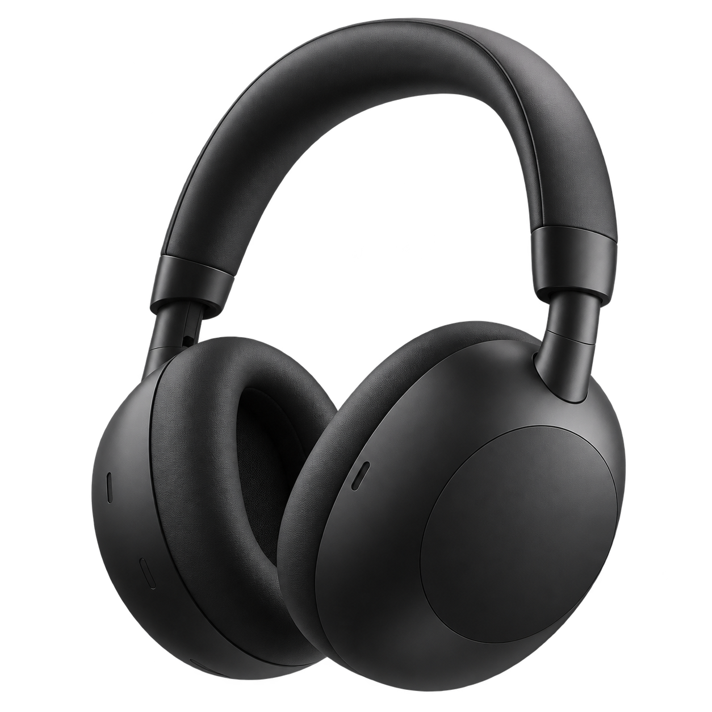
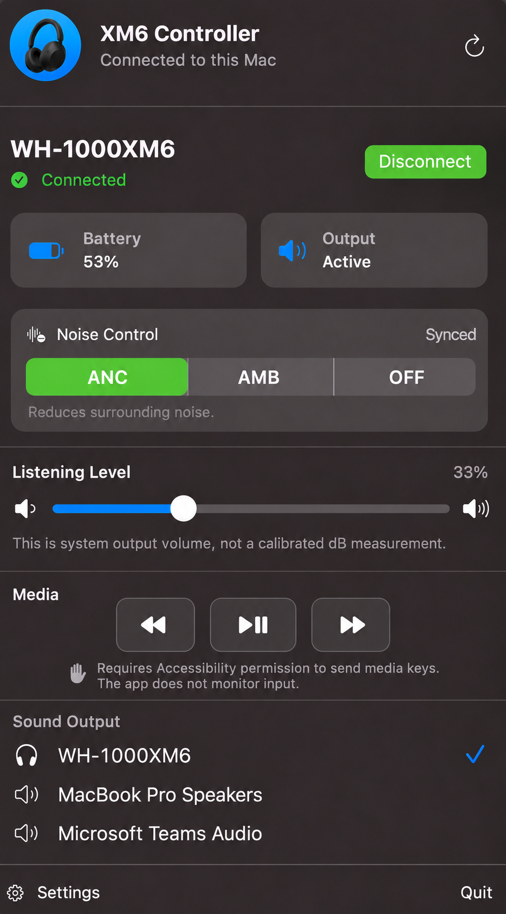

<div align="center">

# XM6 Controller for macOS

**Battery, noise control, equalizer, media, and sound output controls, right from your menu bar.**

[](https://www.apple.com/macos/)
[](https://www.swift.org/)
[](LICENSE)

<table>
  <tr>
    <td align="center" valign="middle" width="45%">
      
    </td>
    <td align="center" valign="middle" width="55%">
      
    </td>
  </tr>
  <tr>
    <td align="center"><sub>WH-1000XM6 · illustrative render</sub></td>
    <td align="center"><sub>Native macOS menu-bar controls</sub></td>
  </tr>
</table>

</div>

XM6 Controller is a lightweight, native SwiftUI companion for Sony WH-1000XM6
headphones. It lives in the menu bar, keeps all data on your Mac, and has no
accounts, analytics, or network service.

## What works

| Feature | Support |
| --- | --- |
| Connection | Find a paired WH-1000XM6, connect, and disconnect |
| Battery | Read percentage and charging state from the headphone |
| Noise control | Noise Cancelling, Ambient levels 1–20, and Off |
| Headphone button sync | Reflect physical NC/AMB changes while open and resync when reopened |
| Wear detection | Show whether the XM6 is worn and refresh while the popover is open |
| Equalizer | Read and select presets, with custom sliders for the XM6-reported band layout |
| Listening level | Read and change the active macOS output volume |
| Media controls | Previous, Play/Pause, and Next for the current macOS system media session |
| Launch at Login | Optional native macOS startup registration in Settings |
| Sound output | List Core Audio devices and switch the default output |
| Verification | Read settings back from the XM6 before showing them as synced |

The Bluetooth controls have been exercised end to end on a real WH-1000XM6,
including repeated ANC, Ambient, Off, battery, wear status, equalizer preset,
custom band, volume, output, and reconnect cycles.

## Equalizer controls

The Equalizer card reads the current setting directly from the headphone and
offers these presets:

- Off
- Heavy
- Clear
- Hard
- Soft
- Custom Bands

Selecting **Custom Bands** reveals the frequency sliders reported by the XM6.
The app supports both known layouts instead of assuming that every firmware
uses the same one:

| Layout | Frequencies | Adjustment range |
| --- | --- | --- |
| 6 bands | Clear Bass, 400 Hz, 1 kHz, 2.5 kHz, 6.3 kHz, 16 kHz | -10 dB to +10 dB |
| 10 bands | 31 Hz, 63 Hz, 125 Hz, 250 Hz, 500 Hz, 1 kHz, 2 kHz, 4 kHz, 8 kHz, 16 kHz | -6 dB to +6 dB |

Band values update locally while a slider is moving. The app sends the new
settings only when the slider is released, which avoids flooding the single
Bluetooth control channel. It then reads the setting back from the headphone
before treating the change as synchronized. Equalizer and noise-control writes
are serialized, so rapid clicks cannot overlap on the same channel.

## Quick start

Requires macOS 14 or newer and a WH-1000XM6 already paired in **System Settings
→ Bluetooth**.

```sh
./scripts/build-app.sh
open "outputs/XM6 Controller.app"
```

There is no Dock window. After launch, select the **S** icon on the right side
of the menu bar. The first media-control click asks for Accessibility permission
so macOS can receive the requested media key. The app does not monitor input.
macOS decides which Now Playing app receives the command; public APIs do not
expose that app's identity to XM6 Controller.
You can also open `Package.swift` directly in Xcode.

Open **Settings** from the popover to enable **Launch at Login**.

## How it works

- SwiftUI provides the menu-bar popover and Settings window.
- IOBluetooth handles the classic Bluetooth connection and the XM6 control
  channel.
- Core Audio supplies the real output-device list and system volume controls.
- A deliberately small Sony v2 protocol implementation handles battery, wear
  status, noise control, and equalizer settings. Requests are serialized so
  refreshes, sliders, and button clicks do not compete for the headphone's
  single channel.

Sony does not publish a supported macOS control API for these features. The
headphone protocol is reverse engineered, so battery, noise control, wear
status, and equalizer support should still be considered experimental. If the
XM6 does not confirm a change, the app shows an error instead of pretending it
succeeded.

## Security and privacy

- Device and audio information stays on the Mac; the app has no networking,
  telemetry, advertising, analytics, or third-party packages.
- Device discovery is restricted to WH-1000XM6 names so XM6 commands are never
  intentionally sent to older Sony protocol generations.
- Incoming control frames are length- and checksum-validated. Raw frame bytes
  are private, debug-level logs rather than public informational logs.
- The optional battery fallback executes the fixed system binary
  `/usr/sbin/system_profiler` with fixed arguments. There is no shell evaluation
  or user-controlled command construction.
- The listening-level display is macOS output volume, not a calibrated dB or
  hearing-exposure measurement.
- The local app is ad-hoc signed and unsandboxed because classic Bluetooth is
  required. Public distribution would additionally require Developer ID
  signing, hardened runtime, notarization, and a final entitlements review.

See the [Security Review Guide](docs/SECURITY_CHECKLIST.md) for the release
security and privacy checks.

## Current limits

Multipoint peer management is not available through this app. Use Sony | Sound
Connect for that feature.

## License

The reverse-engineered protocol behavior is independently implemented in Swift.
Public interoperability research released under open-source licenses informed
the protocol work, but no third-party application source is copied, bundled,
linked, installed, or contacted at runtime.

XM6 Controller is available under the [MIT License](LICENSE). Sony and
WH-1000XM6 are trademarks of their respective owner; this project is independent
and is not affiliated with or endorsed by Sony. The headphone image above is an
illustrative generated render, not official Sony product artwork.
